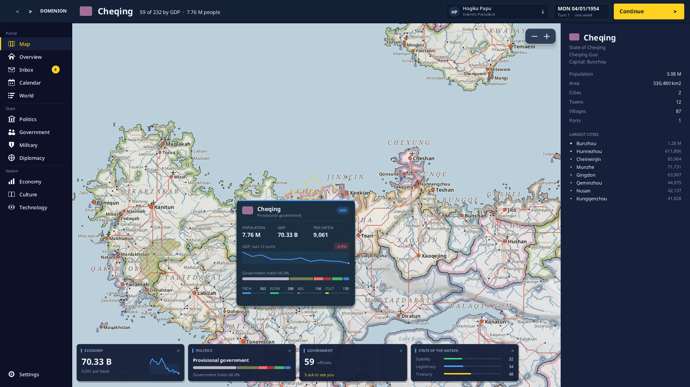
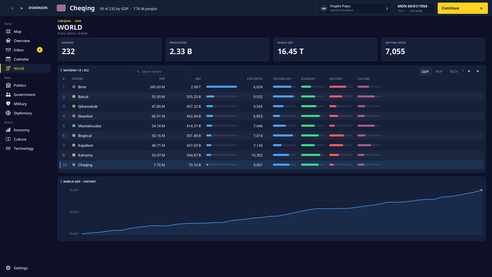
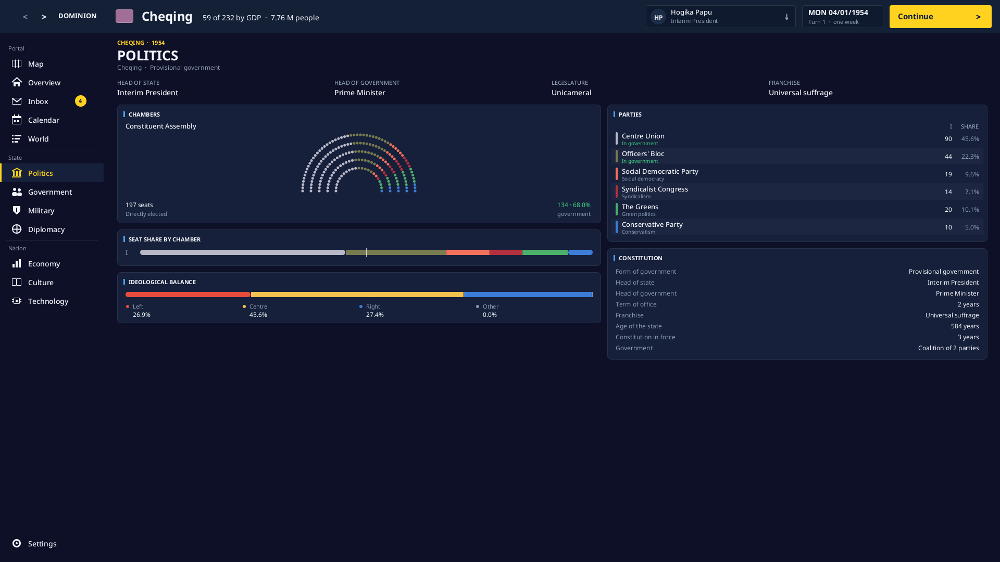
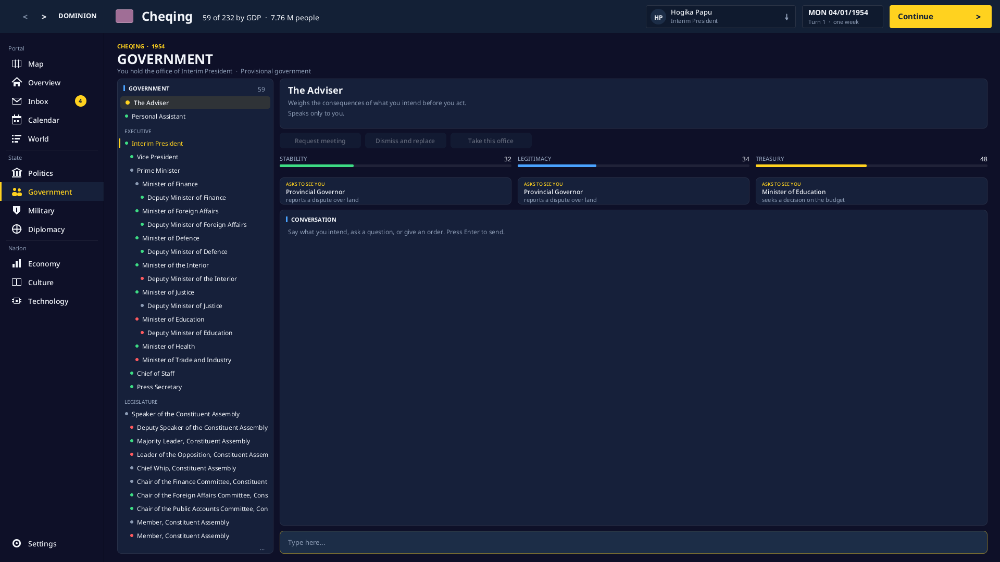
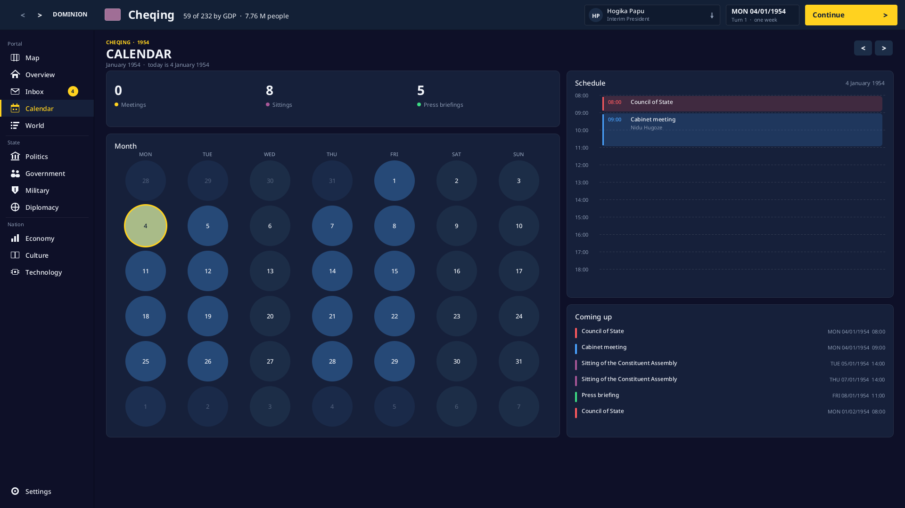
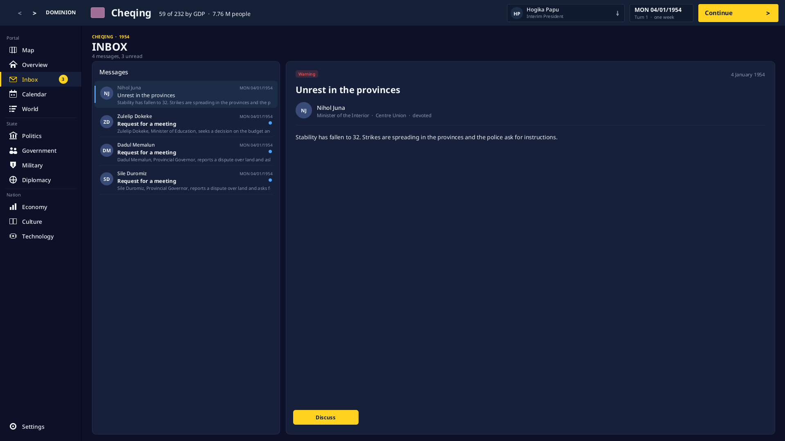

# Dominion

A grand strategy game written entirely in [Swa](https://github.com/lugha-swa/swa), the Swahili systems programming language. The game is one statically linked x86-64 binary built by the Swa compiler alone; it talks to the Linux kernel and the Wayland compositor directly.



You govern one of 232 nations on a hand-built world in the year 1954. Every nation has its own constitution and its own people, and you can serve in any office: head of state, a minister, a member of the legislature, a provincial governor, or a village chief.

## What is in the game

- **A world of 232 nations:** six continents, 1,261 provinces and about 64,000 settlements, with rivers, roads, railways, ports and disputed territories.
- **A constitution for every nation:** twenty forms of government, from parliamentary republics and absolute monarchies to theocracies, juntas, tribal confederations and stateless communes. Zero to four legislative chambers, each with its own seating, size and way of choosing members. Parties across 22 ideologies.
- **A government you can work inside:** a tree of 17 to 108 offices built from the constitution. Appoint and dismiss where the constitution gives you the power; appointments that need confirmation go to a vote in the right chamber. Your personal assistant arranges meetings, superiors can accept, delay or refuse, and officials ask to see you.
- **People who talk back:** with an AI provider switched on, every official answers in character (name, party, temperament, attitude to you) and the Adviser weighs what you intend. Each exchange carries measured consequences for the person's attitude and the nation's stability, legitimacy and treasury, and is remembered.
- **Time:** one turn is one week, starting on Monday 4 January 1954. A calendar of cabinet meetings, sittings, press briefings and your own appointments, and an inbox of requests and warnings every week.
- **47 simulation systems:** economy, population, politics, military, diplomacy, culture, technology and more. Every number on screen comes from them, and each nation starts with a year of economic history.

| | |
|---|---|
|  |  |
| **Overview:** the nation at a glance | **World:** every nation, ranked |
|  |  |
| **Politics:** chambers, parties, constitution | **Government:** offices, meetings, conversation |
|  |  |
| **Calendar:** the state's diary | **Inbox:** requests, diary, warnings |

## Requirements

- Linux on x86-64
- A Wayland compositor (developed on Hyprland)
- The Swa compiler from [lugha-swa/swa](https://github.com/lugha-swa/swa), main branch

## Build and run

```bash
cd swa
swa --programu moduli/programu/dominion.swa > dominion
chmod +x dominion
./dominion
```

Run it from the `swa/` directory: the game reads `rasilimali/` (world and fonts) and writes `saves/` relative to it. It opens full screen; F11 switches to a window.

| Option | Effect |
|---|---|
| `--dirishani` | start in a window instead of full screen |
| `--skrini S` | start on page S |
| `--bila-dirisha W H` | render off-screen at W×H without opening a window (with `--fremu N --dampo file` for captures) |

## Playing

- **Side navigation** opens each page: Map, Overview, Inbox, Calendar, World, Politics, Government, Military, Diplomacy, Economy, Culture, Technology, Settings. Esc returns to the map.
- **Map:** drag to pan, wheel to zoom. Hover over a nation for its card; click to pin the card and open the nation's dossier. The cards along the bottom open their pages.
- **Continue** (top right) or **Space** advances one week.
- **Government page:** choose anyone in the tree. *Request meeting* goes through your assistant; *Dismiss and replace* works where your office has the power; *Take this office* lets you play from any position. Type to speak, Enter to send.
- **Settings:** interface language (English, Kiswahili, Français) and the AI adviser.

### AI adviser

Choose in Settings:

- **Off:** the game makes no network connections.
- **Local model on this computer:** Ollama at `127.0.0.1:11434`.
- **Custom server with API key:** any chat-completions server reachable over plain HTTP.

The address, model and key live in `swa/saves/akili`, created with owner-only permissions:

```
mtoa=2
anwani=127.0.0.1
bandari=11434
modeli=llama3
ufunguo=your-key
tokeni=400
```

`mtoa` is 0 (off), 1 (local) or 2 (custom). The address must be a numeric IPv4 address. Hosted providers that only accept HTTPS need a local gateway that speaks plain HTTP.

## Tests

Every `jaribio_*.swa` under `swa/moduli` is a self-checking test program:

```bash
cd swa
for f in $(find moduli -name 'jaribio_*.swa' | grep -v wayland/jaribio_dirisha); do
  swa --programu "$f" > /tmp/t && chmod +x /tmp/t && /tmp/t /tmp/t.out > /dev/null || echo "FAILED $f"
done
```

## Documentation

- [Architecture](docs/ARCHITECTURE.md): how the code is organised, the frame loop, the world file, rendering, localisation and the AI protocol
- [Naming rules](swa/KANUNI-MAJINA.md) (in Swahili): module prefixes for every part of the code
- [Contributing](CONTRIBUTING.md)

## What is not Swa yet

- `swa/rasilimali/dunia.bin`, the world, was produced from the approved map with external tooling. The generator is being ported to Swa; its random-number core already is (`moduli/dunia/nasibu_mt.swa`).
- The fonts in `swa/rasilimali/fonti` are Noto, under the SIL Open Font License. Swa parses and rasterises them itself.

## License

GNU Affero General Public License v3.0. See [LICENSE](LICENSE).
